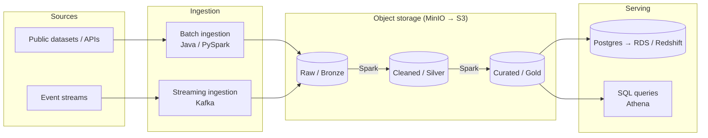

# Data Engineering Labs

A hands-on lab for designing and building production-style data platforms: locally first, then on AWS.

The goal is to build skills as an **AWS data solutions architect**. That means writing pipelines, but also documenting the *why* behind each design: trade-offs, cost, security and how the same architecture maps onto managed AWS services.

---

## Architecture

The target architecture is a medallion-style lakehouse with batch and streaming ingestion:



1. **Ingest:** data lands unchanged in the raw layer.
2. **Process:** Spark jobs clean, validate and model the data into the silver and gold layers (Parquet / Apache Iceberg).
3. **Serve:** curated data is loaded into a relational store or queried in place with SQL.

> This diagram shows the **target** design. See [Project Status](#project-status) for what is built today.

---

## Tech Stack

Each local component has an AWS equivalent, so the same design can be moved to the cloud.

| Concern            | Local (Docker)      | AWS equivalent                     |
|--------------------|---------------------|------------------------------------|
| Object storage     | MinIO               | Amazon S3                          |
| Batch processing   | Apache Spark        | AWS Glue / EMR Serverless          |
| Streaming          | Kafka / Redpanda    | Amazon Kinesis / Amazon MSK        |
| Relational storage | PostgreSQL          | Amazon RDS / Aurora                |
| Warehouse          | PostgreSQL          | Amazon Redshift Serverless         |
| Catalog & query    | Spark SQL           | AWS Glue Data Catalog + Athena     |
| Orchestration      | Apache Airflow      | Amazon MWAA / AWS Step Functions   |
| Governance         | —                   | AWS Lake Formation + IAM           |
| Infrastructure     | Docker / Compose    | Terraform or AWS CDK               |

**Languages:** Java (ingestion), Python / PySpark and SQL (processing).

---

## Project Status

### Phase 1: Local foundation 🚧
- [x] Base container image with Java (`infrastructure/dockerfile`)
- [ ] Docker Compose stack: Spark, PostgreSQL, MinIO
- [ ] Batch ingestion job writing to the raw layer
- [ ] Spark transformations: raw → silver → gold
- [ ] Data quality checks and tests
- [ ] Orchestration with Airflow
- [ ] Streaming ingestion with Kafka / Redpanda

### Phase 2: AWS deployment
- [ ] Infrastructure as code (Terraform or CDK)
- [ ] S3 data lake + Glue Data Catalog + Athena
- [ ] Spark jobs on Glue / EMR Serverless
- [ ] Budget alerts and one-command teardown

### Phase 3: Architecture & operations
- [ ] Architecture Decision Records (`docs/adr/`)
- [ ] Cost estimates for each architecture
- [ ] Security: least-privilege IAM, KMS encryption, Secrets Manager
- [ ] Well-Architected review (Data Analytics Lens)
- [ ] CI/CD with GitHub Actions

---

## Getting Started

### Prerequisites
- [Docker](https://docs.docker.com/get-docker/)
- Git

### Build the base image

```bash
git clone https://github.com/MJMukwevho/data-engineering-labs.git
cd data-engineering-labs

docker build -t data-eng-labs-base -f infrastructure/dockerfile infrastructure
```

### Verify

```bash
docker run --rm data-eng-labs-base java -version
```

> More services (Spark, Postgres, MinIO) will be added through Docker Compose as Phase 1 progresses.

---

## Repository Layout

```
data-engineering-labs/
├── infrastructure/
│   └── dockerfile      # Base image: Arch Linux + OpenJDK 8
├── .gitignore
└── README.md
```

Planned additions:

| Folder        | Purpose                                         |
|---------------|-------------------------------------------------|
| `jobs/`       | Spark and ingestion jobs                        |
| `pipelines/`  | Batch and streaming pipeline definitions        |
| `data/`       | Small sample datasets (large data stays out of Git) |
| `docs/`       | ADRs, architecture diagrams and cost notes      |

---

## Design Decisions

Key decisions will be recorded as Architecture Decision Records in `docs/adr/`. Planned topics:

- Table format: Apache Iceberg vs Delta Lake vs plain Parquet
- Batch compute on AWS: Glue vs EMR Serverless
- Orchestration: Airflow (MWAA) vs Step Functions
- Streaming: Kinesis vs MSK

---

## Philosophy

> Learn by building production-like systems locally before scaling to the cloud.

Running everything locally keeps experiments fast and free. Mapping each component to a managed AWS service makes the move to the cloud a deliberate design exercise rather than a rewrite.

---

## Learning Notes

Short notes on what each lab taught, including mistakes, surprises and trade-offs, will be added here as the project grows.
