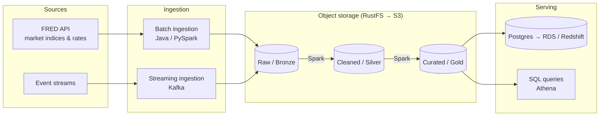

# Data Engineering Labs

A hands-on lab for designing and building production-style data platforms: locally first, then on AWS.

The goal is to build skills as an **AWS data solutions architect**. That means writing pipelines, but also documenting the *why* behind each design: trade-offs, cost, security and how the same architecture maps onto managed AWS services.

---

## Architecture

The target architecture is a medallion-style lakehouse with batch and streaming ingestion:



1. **Ingest:** data lands unchanged in the raw layer.
2. **Process:** Spark jobs clean, validate and model the data into the silver and gold layers (Parquet / Apache Iceberg).
3. **Serve:** curated data is loaded into a relational store or queried in place with SQL.

> This diagram shows the **target** design. See [Project Status](#project-status) for what is built today.

---

## Data Source

All data comes from **[FRED](https://fred.stlouisfed.org/)** (Federal Reserve Economic Data, St. Louis Fed). It's free with an API key and is updated daily.

| Series ID   | Description                         | Frequency |
|-------------|-------------------------------------|-----------|
| `SP500`     | S&P 500 index                       | Daily     |
| `DJIA`      | Dow Jones Industrial Average        | Daily     |
| `NASDAQCOM` | NASDAQ Composite index              | Daily     |
| `VIXCLS`    | CBOE Volatility Index (VIX)         | Daily     |
| `DGS10`     | 10-year US Treasury yield           | Daily     |

Mixing equity indices with interest rates allows gold-layer models such as index performance versus rate changes.

> FRED republishes some series under licence (for example, `SP500` only covers roughly the last 10 years). Check each series' notes on FRED before relying on its history.

---

## Tech Stack

Each local component has an AWS equivalent, so the same design can be moved to the cloud.

| Concern            | Local (Docker)      | AWS equivalent                     |
|--------------------|---------------------|------------------------------------|
| Data source        | FRED API            | FRED API (scheduled by EventBridge)|
| Object storage     | RustFS (S3 API)     | Amazon S3                          |
| Batch processing   | Apache Spark        | AWS Glue / EMR Serverless          |
| Streaming          | Kafka / Redpanda    | Amazon Kinesis / Amazon MSK        |
| Relational storage | PostgreSQL          | Amazon RDS / Aurora                |
| Warehouse          | PostgreSQL          | Amazon Redshift Serverless         |
| Catalog & query    | Spark SQL           | AWS Glue Data Catalog + Athena     |
| Orchestration      | Apache Airflow      | Amazon MWAA / AWS Step Functions   |
| Governance         | —                   | AWS Lake Formation + IAM           |
| Infrastructure     | Docker / Compose    | Terraform or AWS CDK               |

**Languages:** Java (ingestion), Python / PySpark and SQL (processing).

---

## Project Status

### Phase 1: Local foundation 🚧
- [x] Base container image with Java 17 (`infrastructure/dockerfile`)
- [x] Batch ingestion job: FRED → raw layer (`jobs/fred-ingestion`)
- [x] Docker Compose setup for the ingestion job (`compose.yaml`)
- [x] Compose stack: Spark 3.5 cluster, PostgreSQL, S3-compatible object store (RustFS)
- [x] Write raw data to the object store (`s3://lake/raw/`)
- [x] Spark transformations: raw → silver → gold (`jobs/spark/`)
- [x] Data quality checks and unit tests for the transformations
- [ ] Orchestration with Airflow
- [ ] Streaming ingestion with Kafka / Redpanda

### Phase 2: AWS deployment
- [ ] Infrastructure as code (Terraform or CDK)
- [ ] S3 data lake + Glue Data Catalog + Athena
- [ ] Spark jobs on Glue / EMR Serverless
- [ ] Budget alerts and one-command teardown

### Phase 3: Architecture & operations
- [ ] Architecture Decision Records (`docs/adr/`)
- [ ] Cost estimates for each architecture
- [ ] Security: least-privilege IAM, KMS encryption, Secrets Manager
- [ ] Well-Architected review (Data Analytics Lens)
- [ ] CI/CD with GitHub Actions

---

## Getting Started

### Prerequisites
- [Docker](https://docs.docker.com/get-docker/) with Docker Compose
- Git
- A free [FRED API key](https://fred.stlouisfed.org/docs/api/api_key.html)

Java, Maven and Spark are **not** needed on your machine: everything runs inside Docker.
The full stack uses about 3 GB of RAM.

### Set up

```bash
git clone https://github.com/MJMukwevho/data-engineering-labs.git
cd data-engineering-labs

cp .env.example .env        # then open .env and paste your FRED_API_KEY
```

### Start the local stack

```bash
docker compose up -d        # builds images on first run
docker compose ps           # object-store, postgres, spark-master and spark-worker should be running
```

| Service              | Address                                   | Login (defaults from `.env`)        |
|----------------------|-------------------------------------------|-------------------------------------|
| Object store console | http://localhost:9001/rustfs/console/     | `labadmin` / `labadmin-secret`      |
| Object store S3 API  | http://localhost:9000 (bucket `lake`)     | same as above, as access/secret key |
| PostgreSQL           | `localhost:5432`, database `warehouse`    | `lab` / `lab`                       |
| Spark cluster UI     | http://localhost:8080                     | –                                   |
| Spark job UI         | http://localhost:4040 (while a job runs)  | –                                   |

Check that Spark can reach both the object store and PostgreSQL:

```bash
docker compose exec spark-master spark-submit /opt/spark-jobs/smoke_test.py
# ...
# SMOKE TEST PASSED
```

Stop everything with `docker compose down`. Data is kept in Docker volumes; add `-v` to wipe it.

> **Why RustFS and not MinIO?** MinIO stopped publishing its free Docker images in late 2025 and has since archived the project. RustFS is an open-source, S3-compatible replacement. Spark talks to it through the standard `s3a://` connector, so the jobs work against Amazon S3 with only a configuration change.

### Run the FRED ingestion job

```bash
docker compose run --rm fred-ingestion
```

This starts the object store if it isn't running, then writes each series to the `lake` bucket:

```
Writing raw data to s3://lake/raw
OK    SP500 -> s3://lake/raw/fred/series_id=SP500/ingest_date=2026-10-22/observations.json
...
Done: 5 succeeded, 0 failed
```

Browse the files in the object store console under **lake → raw → fred**.

Optional settings in `.env`:

| Variable                 | Default                              | Purpose                                  |
|--------------------------|--------------------------------------|------------------------------------------|
| `FRED_SERIES`            | `SP500,DJIA,NASDAQCOM,VIXCLS,DGS10`  | Comma-separated series to pull           |
| `FRED_OBSERVATION_START` | full history                         | Only fetch observations from this date   |

Each series lands in a Hive-style partition, the layout AWS Glue and Athena expect:

```
s3://lake/raw/fred/series_id=SP500/ingest_date=2026-10-22/observations.json   # FRED response, unchanged
s3://lake/raw/fred/series_id=SP500/ingest_date=2026-10-22/_metadata.json      # lineage; written last
```

Re-running on the same day overwrites that day's partition, so the job is safe to retry.

The job uses the AWS SDK with the standard AWS environment variables. Pointing it at Amazon S3 only means dropping `AWS_ENDPOINT_URL_S3` and `S3_FORCE_PATH_STYLE` and using an IAM role instead of access keys.

> **Reading raw data with Spark:** use `.option("pathGlobFilter", "observations.json")` so Spark skips the `_metadata.json` files.

### Transform: raw → silver → gold

Two Spark jobs turn the raw FRED responses into clean, analysis-ready tables:

```bash
docker compose exec spark-master spark-submit /opt/spark-jobs/fred_silver.py
docker compose exec spark-master spark-submit /opt/spark-jobs/fred_gold.py
```

| Layer  | Location | Contents |
|--------|----------|----------|
| Silver | `s3://lake/silver/fred_observations/` (Parquet, by `series_id`) | One row per series and date: typed date and `decimal(18,4)` value; FRED's `"."` (no data, e.g. a holiday) becomes NULL; when loads overlap, the most recent load wins |
| Gold   | `gold.equity_index_performance` (PostgreSQL) and `s3://lake/gold/equity_index_performance/` | S&P 500, Dow and NASDAQ: value, daily return, and 21-trading-day annualised volatility |
| Gold   | `gold.market_daily` (PostgreSQL) and `s3://lake/gold/market_daily/` | One row per date, one column per series (`sp500`, `vixcls`, `dgs10`, …) |

Both jobs rebuild their output from the layer below, so re-running is safe. The silver job runs **data quality checks** (no duplicates, no unparseable or future dates, no negative values) and writes nothing if one fails.

Try a query:

```bash
docker compose exec postgres psql -U lab -d warehouse -c \
  "select observation_date, value, daily_return, volatility_21d_annualized
     from gold.equity_index_performance
    where series_id = 'SP500' order by observation_date desc limit 10"
```

Run the transformation unit tests (no storage needed):

```bash
docker compose exec spark-master python3 -m unittest discover -s /opt/spark-jobs/tests -v
```

### Run without Docker (optional)

With Java 17+ and [Maven](https://maven.apache.org/) installed:

```bash
cd jobs/fred-ingestion
mvn package
FRED_API_KEY=your_key_here RAW_DATA_LOCATION=../../data/raw java -jar target/fred-ingestion-0.1.0.jar
```

`RAW_DATA_LOCATION` accepts a local folder (as above) or an `s3://bucket/prefix` location.

---

## Repository Layout

```
data-engineering-labs/
├── compose.yaml        # Local environment (docker compose)
├── .env.example        # Template for your local settings and API key
├── data/
│   └── raw/            # Raw layer when running without Docker (git-ignored)
├── infrastructure/
│   ├── dockerfile      # Base image: Arch Linux + OpenJDK 17
│   ├── spark/          # Spark 3.5 image with S3 and PostgreSQL connectors
│   └── postgres/init/  # SQL run when the database is first created
├── jobs/
│   ├── fred-ingestion/ # Java job: FRED API → raw layer (own Dockerfile)
│   └── spark/          # PySpark jobs, mounted into the Spark containers
│       ├── transforms.py     # Pure transformation functions (unit-tested)
│       ├── fred_silver.py    # Raw → silver job, with data quality checks
│       ├── fred_gold.py      # Silver → gold job (lake + PostgreSQL)
│       ├── smoke_test.py     # Checks Spark can reach storage and PostgreSQL
│       └── tests/            # Unit tests for transforms.py
├── .gitignore
└── README.md
```

Planned additions:

| Folder        | Purpose                                         |
|---------------|-------------------------------------------------|
| `pipelines/`  | Batch and streaming pipeline definitions        |
| `data/`       | Small sample datasets (large data stays out of Git) |
| `docs/`       | ADRs, architecture diagrams and cost notes      |

---

## Design Decisions

Key decisions will be recorded as Architecture Decision Records in `docs/adr/`. Planned topics:

- Table format: Apache Iceberg vs Delta Lake vs plain Parquet
- Batch compute on AWS: Glue vs EMR Serverless
- Orchestration: Airflow (MWAA) vs Step Functions
- Streaming: Kinesis vs MSK

---

## Philosophy

> Learn by building production-like systems locally before scaling to the cloud.

Running everything locally keeps experiments fast and free. Mapping each component to a managed AWS service makes the move to the cloud a deliberate design exercise rather than a rewrite.

---

## Learning Notes

Short notes on what each lab taught, including mistakes, surprises and trade-offs, will be added here as the project grows.
